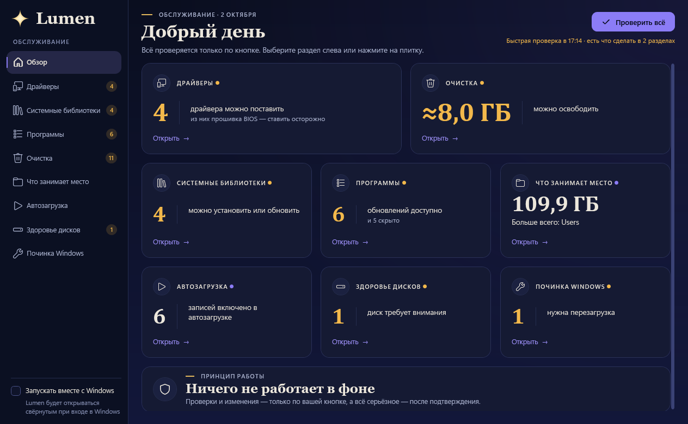

# Lumen

Программа для Windows, которая делает только обслуживание компьютера. Всё — по кнопке, ничего не работает в фоне.

## Что умеет
- **Драйверы** — видеокарты и устройства с ошибками, поиск драйверов в Центре обновления Windows, установка отмеченных (с точкой восстановления);
- **Системные библиотеки** — Visual C++, DirectX, .NET, Java: чего не хватает программам и играм;
- **Программы** — обновления из каталога winget;
- **Очистка** — кеши, временные файлы, мусор проектов (включая кэш Steam), корзина;
- **Что занимает место** — карта диска, крупные файлы, старые установщики, дубликаты (личные файлы уходят только в Корзину);
- **Автозагрузка**, **здоровье дисков**, **починка Windows** (DISM и sfc).

## Принципы
- Lumen сам ничего не делает: проверки и изменения запускаются только вашим нажатием, а важное — после подтверждения.
- Никаких фоновых служб. Закрыли окно — программа закрылась. Единственная настройка — галочка «Запускать вместе с Windows» (по умолчанию выключена).
- Для действий с правами администратора (драйверы, точка восстановления, очистка системных папок) есть маленький помощник администратора. Windows спрашивает «Да» один раз; дальше помощник проверяет каждое действие. Без него остальное работает.

## Требования
Windows 10 или 11, 64-bit. Права администратора для установки не нужны.

## Скачать
Готовый установщик лежит в разделе Releases: https://github.com/beep-jeep-inc/lumen/releases/latest — файл `Lumen.rar` (внутри «Установка Lumen.exe» и «Как установить.txt»).

## Установка
1. Распакуйте `Lumen.rar` (двойной щелчок, «Извлечь»).
2. Запустите «Установка Lumen», нажимайте «Далее» и «Установить».
3. Если Windows пишет «Система Windows защитила ваш компьютер» (программа не подписана): «Подробнее» → «Выполнить в любом случае».
4. Открыть Lumen — ярлык в меню «Пуск» или на рабочем столе.

Удаление — «Параметры» → «Приложения» → Lumen; установщик спросит, убрать ли заодно и помощника.

## Сборка из исходников
Нужны .NET 8 SDK, для помощника (NativeAOT) — MSVC Build Tools; для установщика — Inno Setup 6 и WinRAR.

- `dotnet build Pult.sln -c Release` и `dotnet test Pult.sln -c Release`;
- `powershell -NoProfile -ExecutionPolicy Bypass -File .\publish.ps1` — тесты и публикация в `.\publish`;
- `publish.ps1 -Installer` — ещё и `publish\Установка Lumen.exe` и `publish\Lumen.rar`;
- `publish.ps1 -Install` — копирует программу в `%LOCALAPPDATA%\Programs\Pult`.

Версия — в `Directory.Build.props`. Иконка — `python tools\make_icon.py src\Pult.App\Assets\pult.ico` (нужен Pillow).

## Технические подробности
Внутренние имена остались от прежнего названия «Пульт»: `Pult.exe`, `PultAdmin.exe`, папки `%LOCALAPPDATA%\Programs\Pult`, `%APPDATA%\Pult`, `C:\Program Files\Pult` (помощник), `C:\ProgramData\Pult`, задания планировщика «Pult Admin» и «Pult System». Так обновление поверх старой установки сохраняет настройки.

- Настройки: `%APPDATA%\Pult\config.json`, журнал: `%LOCALAPPDATA%\Pult\pult.log`.
- Установка помощника вручную: `PultAdmin.exe --install --user "ПК\пользователь"` от администратора; удаление — `PultAdmin.exe --uninstall`.
- Установленный помощник сам не обновляется: если рядом с `Pult.exe` лежит другой настоящий NativeAOT `PultAdmin.exe` (хеш SHA256 вшит в `Pult.exe` при сборке), Lumen предложит обновить его одним окном «Да».
- Снимок окна с вымышленными данными: `Pult.exe --preview maintenance-demo --shot файл.png [--size ШxВ]`.
